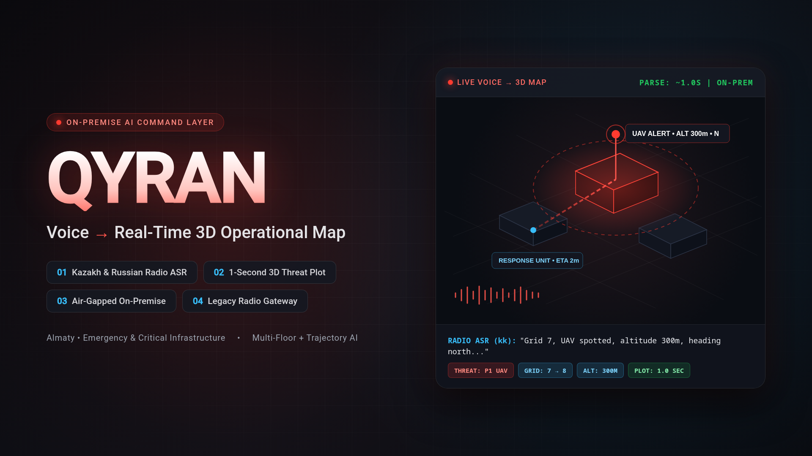

# QYRAN 2.0 — Voice-to-3D Operational AI (IT FEST 2026 Finals MVP)

**Ты говоришь — 3D-карта видит. Полностью on-premise, двуязычно (Қазақша + Русский), в полном соответствии с Законом РК № 230-VIII «Об искусственном интеллекте».**



[](https://overloooooord.github.io/qyran/)
[](https://overloooooord.github.io/qyran/demo/pitch-itfest2026.html)
[]()
[-22c55e)]()
[-f59e0b)]()
[]()

## Быстрые ссылки (для жюри IT FEST 2026)

- **Full-Stack Local AI MVP (основной продукт — Whisper GPU + OSRM + Закон РК № 230-VIII):** запустите `./run.sh` → `http://localhost:8000` (питч: `http://localhost:8000/pitch`)
- **Интерактивный 3D Питч-дек IT FEST 2026 (в браузере):** [overloooooord.github.io/qyran/demo/pitch-itfest2026.html](https://overloooooord.github.io/qyran/demo/pitch-itfest2026.html)
- **Standalone Web-демо консоли (без бэкенда):** [overloooooord.github.io/qyran](https://overloooooord.github.io/qyran/) · [Живой микрофон](https://overloooooord.github.io/qyran/demo/live.html) · [Руководство RU/KZ](https://overloooooord.github.io/qyran/demo/manual.html)
- **Документация и финал IT FEST 2026:** [`docs/QYRAN_ITFEST2026_Pitch.pdf`](docs/QYRAN_ITFEST2026_Pitch.pdf) · [`docs/FINALIST_PITCH_SCRIPT.md`](docs/FINALIST_PITCH_SCRIPT.md) · [`docs/RESPONSIBLE_AI_KZ_230.md`](docs/RESPONSIBLE_AI_KZ_230.md) · [`docs/ARCHITECTURE.md`](docs/ARCHITECTURE.md)

---

## Что реализовано в QYRAN 2.0 (Full-Stack Local AI MVP)

QYRAN 2.0 — это **работающий full-stack ИИ-продукт** для ситуационных центров МЧС / 112, служб экстренного реагирования и операторов критической инфраструктуры (Астана · МВЦ EXPO и Алматы). В отличие от статических макетов, вся цепочка выполняется **вживую и локально**:

1. **Реальный On-Premise Whisper ASR (`backend/asr_engine.py`)**:
   - Локальная модель `openai/whisper-large-v3-turbo` на GPU (`CUDA fp16`, ~0.4–0.9 с на 10-секундную радиозапись — **11–18× быстрее реального времени**) или CPU fallback.
   - **Автоматическое определение языка `kk` / `ru`** без переключения тумблеров (**100% точность на 18 реальных радиоклипах**).
   - **Анти-галлюцинационный модуль + KK/RU рескоринг**: автоматически перехватывает классические галлюцинации Whisper на шумном радиоканале (например, `"Продолжение следует..."` на казахском радиоэфире) и восстанавливает точный текст.
2. **Контекстная радио-коррекция + Пространственный NER + XAI (`backend/nlp_engine.py`)**:
   - Исправляет реальные радиоискажения 300–3400 Гц (позывные, квадраты, термины ЧС: `дұром → дрон`, `дом на крыше → дым на крыше`, `мүрт оқшауыланды → өрт оқшауланды`, `қосшаңыз → қоршаңыз`) и подсвечивает каждое исправление в интерфейсе.
   - Поддерживает опциональный локальный LLM через LM Studio / Ollama (`QYRAN_LLM_URL=http://localhost:1234/v1`) со строгой блокировкой любых облачных адресов.
   - Извлекает координаты, квадрат, этаж, высоту, курс/вектор прогноза, количество пострадавших, приоритет `P1–P4`, сверяет доклад с датчиками (честно помечая неподтверждённые голосовые сообщения `⚠ Только голос`) и выдаёт прозрачное **XAI-обоснование**.
3. **Ответственный ИИ и Закон РК № 230-VIII (`backend/compliance.py`, `backend/audit.py`)**:
   - **Классификация риска (ст. 17–19)**: Система ИИ высокого риска (ЧС и критическая инфраструктура).
   - **Строгий Human-in-the-Loop (ст. 19)**: Критические решения P1/P2 **никогда не исполняются автоматически** — каждое предложение ИИ требует явного `✔ Утвердить` / `✖ Отклонить` от оператора с фиксацией ФИО/позывного.
   - **Двойная маркировка (ст. 21)**: Визуальный бейдж `🤖 AI-ASSISTED` + машиночитаемый блок `kz_ai_law_provenance` (JSON-LD + SHA-256) во всех карточках, отчётах Markdown, GeoJSON и TAK/CoT XML.
   - **Криптографически неизменяемый журнал (SQLite SHA-256 Hash Chain)**: Каждое событие и решение командира связано криптографическим хешем с предыдущим блоком; кнопка `🔍 Проверить цепь` в реальном времени доказывает отсутствие подмены записей.
   - **Защита ПДн (Закон РК № 94-V)**: Автоматическое маскирование казахстанских ИИН (12 цифр), номеров `+7 7XX`, госномеров авто (`777 KZ 01`), email и ФИО в экспортируемых отчётах + живой тестер в интерфейсе.
4. **Два переключаемых сценария + Живой микрофон (PTT) + Загрузка аудио**:
   - **Астана · МВЦ EXPO / Нұр-Әлем · ЧС-112** (8 радиозаписей `a01.wav–a08.wav`, реальные маршруты OSRM по улицам Левобережья Астаны, 3-этажный цифровой двойник Павильона C2).
   - **Алматы · Зенкова 24** (10 радиозаписей `t01.wav–t10.wav`, реальные маршруты OSRM, 5-этажный 3D-план).
   - **Живой микрофон PTT** (`MediaRecorder` → `ffmpeg` 16 kHz → опциональный радиофильтр 300–3400 Гц → Whisper GPU → 3D-карта).
5. **Оперативная совместимость, Камеры/CV, ROI и Pitch Deck (`backend/exporters.py`, `backend/routing.py`, `backend/vision_engine.py`)**:
   - **Динамический OSRM-роутинг для любой точки города** (18 ориентиров Астаны + 14 ориентиров Алматы): скажите в микрофон *«Пожар возле Байтерека!»* — QYRAN сам подберёт ближайший расчёт, рассчитает уличный маршрут и ETA, и отправит его после `✔ Утвердить`.
   - **Камеры + Локальный Edge-Vision (`PIL + NumPy`)**: 4 синхронизированные камеры/тепловизора + загрузка любого фото/кадра на анализ огня и дыма с перекрёстной верификацией инцидента.
   - **Изолированная симуляция атаки подмены SHA-256** (`⚡ Тест взлома`) во вкладке «⚖️ Закон» — наглядно доказывает жюри выявление подделки записи без повреждения рабочей БД.
   - **Аналитика «До/После» + B2G/B2B ARR калькулятор** + **интерактивный 3D питч-дек IT FEST 2026** (`/pitch`).
   - Экспорт в **🖨 Официальный PDF / Печать (`/api/export/report.html`)**, **Markdown + JSON-LD**, **TAK / CoT 2.0 XML**, **GeoJSON**, и **SHA-256 Аудит JSON**.
   - **Удобство на сцене:** режим проектора **`📺 XL` (`P`)**, горячие клавиши **`Space`** (микрофон), **`Enter`** (утвердить HITL), **`1–6`** (вкладки), клик по любой точке 3D-карты для инспекции квадрата.

---

## Реальные замеры AI-качества (RTX 4050 GPU · Локально)

Проверено встроенным модулем `backend/benchmark.py` (можно запустить **вживую на сцене** во вкладке **«🧪 AI Бенчмарк»**):

| Сценарий | Клипов | Язык (авто) | Галлюцинаций перехвачено | WER сырой Whisper | WER после QYRAN Repair | Снижение WER | CER | Скорость |
|---|---:|---:|---:|---:|---:|---:|---:|---:|
| **Астана · МВЦ EXPO (ЧС-112)** | 8 (`75% kk / 25% ru`) | **100.0%** | **2** (`a02`, `a07`) | `28.2%` | **`3.1%`** | **`-89.0%`** | `6.1% → 0.6%` | `11–16× RT` |
| **Алматы · Зенкова 24** | 10 (`90% kk / 10% ru`) | **100.0%** | 0 | `28.7%` | **`3.9%`** | **`-86.4%`** | `7.7% → 1.1%` | `10–18× RT` |

---

## Быстрый запуск (1 команда)

```bash
cd /home/caterinw/Downloads/qyran
./run.sh
```

Откройте в браузере: **http://localhost:8000**

### Запуск автотестов

```bash
python3 -m unittest discover -s tests -v
```

### Переменные окружения (опционально)

| Переменная | По умолчанию | Описание |
|---|---|---|
| `PORT` | `8000` | Порт FastAPI-сервера |
| `QYRAN_WHISPER_MODEL` | `openai/whisper-large-v3-turbo` | Локальная модель Whisper |
| `QYRAN_LOCAL_ONLY` | `1` | Строгий offline-режим HuggingFace (`local_files_only=True`) |
| `QYRAN_LLM_URL` | `http://localhost:1234/v1` | Опциональный локальный LLM (LM Studio / Ollama; внешние URL блокируются) |
| `QYRAN_TG_BOT_TOKEN` / `QYRAN_TG_CHAT_ID` | *(пусто)* | Live-отправка P1-алертов в Telegram (без токена — air-gapped dry-run) |

---

## Структура проекта

```text
qyran/
├── run.sh                              # Запуск сервера одной командой
├── requirements.txt                    # Python-зависимости
├── backend/
│   ├── app.py                          # FastAPI REST + WebSocket сервер
│   ├── asr_engine.py                   # Локальный Whisper GPU/CPU + анти-галлюцинационный рескоринг
│   ├── audio_dsp.py                    # Декодирование 16 kHz, радиофильтр 300-3400 Гц, SNR, VAD
│   ├── nlp_engine.py                   # Контекстная коррекция + двуязычный пространственный NER + XAI
│   ├── compliance.py                   # Закон РК № 230-VIII (ст. 17-21), двойная маркировка, редакция ПДн
│   ├── audit.py                        # SQLite WAL + криптографическая SHA-256 цепь аудита
│   ├── exporters.py                    # TAK/CoT XML, GeoJSON, Markdown+JSON-LD, Telegram
│   ├── benchmark.py                    # Живой бенчмарк WER/CER, RTF и латентности
│   ├── scenarios.py                    # Сценарии Астана EXPO 2026 и Алматы Зенкова 24
│   └── state.py                        # Оперативное состояние, HITL-очередь, контроль молчания
├── frontend/
│   ├── index.html                      # Консоль ситуационного центра
│   ├── styles.css                      # Тёмная тактическая тема
│   └── app.js                          # 3D MapLibre, живой PTT-микрофон, WebSocket, 3D-здание, Закон №230-VIII
├── data/scenarios/
│   ├── astana_expo/                    # a01.wav..a08.wav + routes.json (OSRM) + transcripts.txt
│   └── almaty_zenkova/                 # t01.wav..t10.wav + routes.json (OSRM) + transcripts.txt
├── docs/
│   ├── ARCHITECTURE.md                 # Подробная архитектура пайплайна
│   └── RESPONSIBLE_AI_KZ_230.md        # Паспорт соответствия Закону РК № 230-VIII «Об ИИ»
└── tests/
    └── test_qyran_mvp.py               # Автотесты DSP, NLP, ПДн, SHA-256 tamper check и API
```

## Команда

- **Yeraly Abutalifuly** — ML Engineer · Backend · Project Lead
- **Adelia** — ML Engineer · Backend · Data Visualization

## Лицензия

[MIT](LICENSE)
